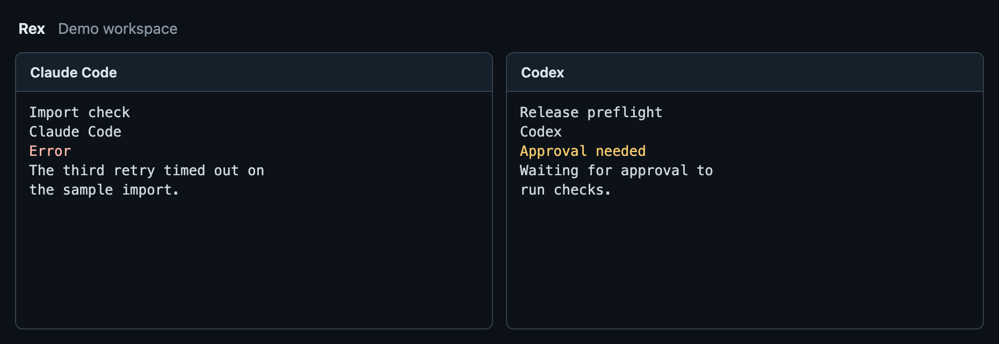
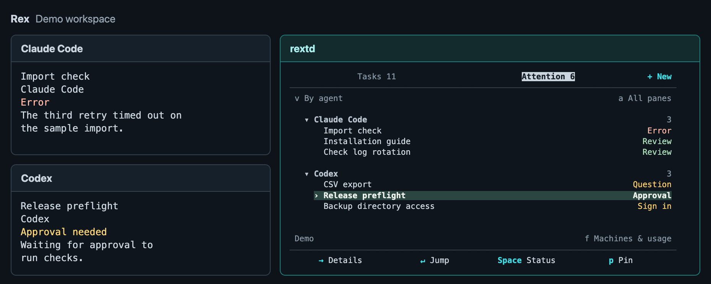

# rextd

rextd is a task sidebar for Rex. Keep a local task list, see which agents need your attention, and jump back to the right pane. Organize linked sessions and panes under each task, and group Attention by Rex session, agent, or host.

[Read the user guide](docs/user-guide.md) to install rextd and link your first task to a Rex pane.

## Before and after

**Before rextd.** Read the error or approval request in each Rex pane.



**With rextd.** Attention groups the same panes by agent, shows their status, and gives you a shortcut back to the pane.



The comparison uses fictional pane names, tasks, hosts, and usage figures in an isolated Rex session.

## Install and open the sidebar

Download the archive for your platform and its `.sha256` file. The published package is **v0.0.1**. Build from `main` to use the [latest source changes](#try-from-a-source-checkout), including the `td` palette actions and **Mark seen**. [GitHub Releases](https://github.com/anewme7/rextd/releases)

The current packages start in English. Press Shift+L in the sidebar to switch to Simplified Chinese.

For example, on Apple Silicon:

```sh
curl -fLO https://github.com/anewme7/rextd/releases/latest/download/rex-td_darwin_arm64.tar.gz
curl -fLO https://github.com/anewme7/rextd/releases/latest/download/rex-td_darwin_arm64.tar.gz.sha256
shasum -a 256 -c rex-td_darwin_arm64.tar.gz.sha256
tar -xzf rex-td_darwin_arm64.tar.gz
cd rex-td_darwin_arm64
```

On Linux x86-64, download `rex-td_linux_amd64.tar.gz` and its checksum, then run:

```sh
sha256sum -c rex-td_linux_amd64.tar.gz.sha256
tar -xzf rex-td_linux_amd64.tar.gz
cd rex-td_linux_amd64
```

From the extracted directory, run this inside an open Rex pane:

```sh
rex run --split=right --ratio 35 --shell=none --label rextd -- "$PWD/rextd"
```

The packaged binary needs Rex with its CLI on `PATH` for live pane status and jumps. SQLite is bundled. Go and a compiler are needed only to build from source.

### Try the demo

Run `./rextd --demo` from the extracted directory, or add `--demo` to the end of the Rex launch command above. Press Tab to see the sample Attention list. Press Right to inspect a task or pane, and `q` to exit. The Go demo keeps its sample data in memory.

### Try from a source checkout

Use Go 1.23 or later. On macOS, enable CGO and install the Xcode command line tools to compile native CPU sampling.

```sh
git clone https://github.com/anewme7/rextd.git
cd rextd
mkdir -p bin
go build -o ./bin/rextd ./cmd/rex-td-preview
rex run --split=right --ratio 35 --shell=none --label rextd -- "$PWD/bin/rextd"
```

To use the command palette with a source build, [build and extract an archive](#build-an-archive). The archive keeps the binary and Lua actions together.

For a quick English demo outside Rex, run `go run ./cmd/rex-td-preview --demo --lang en`.

### Switch languages

Press **Shift+L** in the sidebar to switch between English and Simplified Chinese without leaving your current view. Lowercase `l` links panes on the Attention tab.

Start in Chinese with `./rextd --lang zh` or in English with `./rextd --lang en`. Append the flag after the executable when launching through Rex. For direct launches, `REX_TD_LANG=zh` sets the default to Chinese and an explicit `--lang` flag takes precedence. Task titles, notes, and live pane names stay as entered.

## Use the sidebar

### Create a task and link a pane

1. Open **Tasks (任务)** and press `+`. Enter a title and press Enter to save it.
2. Select the task. Press Right to expand it and Right again to see its details, or press `o` to open details directly.
3. In details, press `l` to choose a Rex pane and Enter to link it. Select a linked pane and press Enter to jump to it.

Click a task's checkbox or press `x` to mark it done or reopen it. Press `m` to reorder, cancel, and archive tasks, edit the next step, or add subtasks. Press Shift+A to see archived tasks and `/` to find a task.

### Review agent activity

**Attention (需要处理)** shows approvals, questions, sign-ins, errors, and completed turns that need review. Use `v` to group panes by session, agent, or host. Press Right on a pane to see its reported activity and next action, or Enter to jump straight to it.

In pane details, press `m` for session metadata or Enter to jump. For provider setup, see [Agent session details](#agent-session-details).

On builds from `main`, press `y` or click **Mark seen** to clear a reviewed completion from Attention. Press `a` in Attention to show all panes, then open the pane again to undo the mark. New activity can bring the reminder back. Approvals and task checkboxes are independent of seen marks.

### Review suggested tasks

In **Attention**, open a Codex or Claude Code pane's details. Press `d` to discover a candidate now, or `w` to toggle watching the pane. Watched panes use the existing Rex status updates to suggest work when there is an active status and a usable title. The title can come from the agent, a named pane, or a named window containing a single agent.

In **Tasks**, select **Candidates** below the task list and press Enter to expand it. Select a candidate and press Enter to review its source and change the title if needed. Press Enter again to save the task and its pane link together. Press `i` on a candidate to ignore the topic. The sidebar remembers which panes you watch and which topics you ignored.

### Groups, mouse, and resources

- **Groups** organize Attention by Session, Agent, or Host. Press `v` to switch. Host view nests sessions under each host. Press `c` to fold or open the current group, or Shift+C for the whole host. The Tasks tab keeps tasks at the top level, with linked sessions inside each task. Pinned items appear first.
- **Mouse and touch** can switch tabs, change grouping or alert scope, fold group headers, select a row, expand a task by its arrow, and use the bottom shortcuts. Use the scroll wheel to move through list rows. Touch requires a Rex client that forwards taps as terminal mouse events.
- **Resources** shows numbered hosts, CPU percentages, and the count of panes needing attention. Each provider shows its next reset and the used percentage for each quota window. A dash marks an unavailable reading. Click the resources prompt or press `f` to open that section. The host details also show session and window counts. On `main`, resource sampling stops when you close this section. Press Esc to return to the list.

| Key | Action |
| --- | --- |
| `+` | Create a task |
| Tab | Switch between Tasks and Attention |
| `v` / `a` | Switch grouping / toggle all panes in Attention |
| `c` / `Shift+C` | Fold or open the current group / the whole host in Host view |
| Up / Down or `k` / `j` | Move the selection |
| Right / `o` | Expand a task or open an expanded task's details / open details directly |
| Enter | Jump to a linked pane or choose one from task details |
| `x` / `m` | Mark a task done or reopen it / open the task menu |
| `y` | Mark a completed pane result as seen or undo the mark (builds from `main`) |
| `/` / Shift+A | Search tasks / open the archive |
| `l` | Pick a pane from task details, or link or unlink the highlighted pane in Attention |
| Shift+L | Switch between English and Simplified Chinese in the bilingual build |
| Space | Show the selected task or pane status |
| `p` | Pin or unpin the selected task or pane |
| `b` / `z` | Change the task title accent / cycle the three display densities |
| `t` | Change the task type in task details |
| `f` / `g` | Move focus between resources and the list / clear the host filter |
| `?` / `q` | Show help / quit |

Task pins stay in the task database. Attention pins last for the current sidebar run. Rex reports active pane titles and status. Task membership follows the links you make in the sidebar.

## Optional integrations

| Feature | Setup |
| --- | --- |
| Rex hosts and pane status | Open the sidebar inside Rex. Connected hosts appear automatically. |
| Cross-host jumps | Connect the Rex app to both servers, use a unique Rex client label, and enable Rex Remote Control for tab switches. |
| Local CPU | The macOS build reads Mach counters. The Linux build reads `/proc/stat`. |
| Remote CPU | Enable the CPU action on each server you want to monitor. |
| Claude Code usage | Connect Claude Code's status line. |
| Codex usage | Put `codex` on `PATH` and sign in. The sidebar reads usage from the local Codex App Server. |
| Rex command palette | Load the bundled Lua actions to open the board, find a task, capture a pane, or filter by host. |

### Add rextd to the Rex command palette

Copy the block from [rex/init.example.lua](rex/init.example.lua) into your Rex `init.lua`. Set `rextd_root` to the absolute path of the extracted directory containing the `rextd` binary and the `rex/` folder. Run `rex config check` and `rex config reload` on that Rex server.

On macOS, open the Rex command palette with **Shift+Command+P**. Search for **td** with a build from `main`, or **rextd** with the v0.0.1 download.

- **Open Task Board** opens a sidebar beside your current pane or focuses the existing one.
- **Find Task** finds an active task and jumps to a linked pane. On `main`, the picker shows the host, agent, and status for multiple links. If the pane is unavailable, Find Task opens the task with its links and next step.
- **Capture Current Pane** creates a task from the current pane or links it to an existing task.

With a build from `main`, use **Open Task Board** to return to the selected task after a jump. To jump across hosts, connect your Rex app to both hosts, give the client a unique label, and enable Rex Remote Control for tab switches.

**Show Host 1** filters Attention in a rextd pane in the current window. Inside the sidebar, Alt+1 through Alt+9 select numbered hosts and Alt+0 shows all hosts.

Set `rextd_language = "zh"` for Chinese action titles and new sidebars. If you use a custom `REX_TD_DATA_DIR` when starting rextd, set `rextd_data_dir` to that same absolute directory in the Rex config so the board and the palette share your task list.

### Agent session details

Press Right on an Attention row, then `m` to expand the Agent metadata. Claude Code matches a local session to the pane's foreground process with `claude agents`. For Codex, press `i` in pane details and enter the agent's session ID to verify and link it using the local Codex App Server.

To make the same lookup available for a remote pane, uncomment the Agent details line in the Rex example config on that pane's host. Agent tools must be installed on the host with the pane.

Claude Code's latest reply can be read with the optional bundled reader. Install Node.js, copy `rex/agent-details/read.mjs` to `~/.config/rex/rextd/agent-details/claude-reader/` on the pane's host, then run `npm install --save-exact @anthropic-ai/claude-agent-sdk@0.3.329` from that directory. Use the matching path under `$XDG_CONFIG_HOME` if you set it.

### Enable remote CPU

1. Copy [rex/metrics.lua](rex/metrics.lua) to the target Rex server.
2. Add the following line to that server's Rex `init.lua`. Use the absolute path to the copied file. Rex normally reads `~/.config/rex/init.lua`, or `$XDG_CONFIG_HOME/rex/init.lua` when set. For a shared server, use the [service account's configuration](https://www.superlogical.com/rex/docs/linux/shared-server).

   ```lua
   dofile("/absolute/path/to/metrics.lua")
   ```

3. For a macOS server, copy the matching `rextd` binary to the server. Above the `dofile` line, set `rex_td_preview_binary = "/absolute/path/to/rextd"`. On Linux, the Lua action reads `/proc/stat` directly.
4. On the target server, run `rex config check` and `rex config reload`. Reopen the sidebar to discover the action. Reachability and pane counts already work through Rex. [Rex server configuration](https://www.superlogical.com/rex/docs/customize/config)

To remove remote CPU collection, remove the lines you added to the server's `init.lua` and reload Rex on that server.

### Enable Claude Code usage

Merge [rex/claude-statusline.example.json](rex/claude-statusline.example.json) into the settings for the Claude Code profile you want to display. Set its command to your executable's absolute path followed by `--claude-statusline`. If you already have a status-line script, forward a copy of its JSON input to that command and keep your script in place. Claude Code sends supported five-hour and weekly windows after the first response in a session. The sidebar replaces one local cache with the latest reading. [Claude Code status line](https://code.claude.com/docs/en/statusline)

If a local Claude Code pane reports that its weekly quota is exhausted, rextd uses that status to show 100% weekly usage until the reported reset. This works before Claude Code sends its first status-line usage reading.

## Data, updates, and removal

Tasks, types, colors, pins, results, and pane links are stored in `~/.local/share/rex-td/tasks.sqlite3` by default. An absolute `REX_TD_DATA_DIR` takes priority over `$XDG_DATA_HOME/rex-td`, when set. Demo data lives in memory. CPU readings and live pane events stay out of the task database. A build from `main` stores a fingerprint and timestamp for each acknowledged pane.

The database is local to the machine running rextd. Task notes, results, and linked pane names may contain private information. Use demo mode for shareable screenshots and keep your task database, runtime logs, and personal configuration out of commits and issue attachments.

Close the sidebar before copying its database for backup. To update, close the sidebar and extract the newer archive. If you use Rex actions, update `rextd_root` to the new directory and reload Rex. To uninstall, close the sidebar, remove the extracted program, and remove any optional Rex or Claude settings you added. Keep the data directory to use the saved tasks again.

## Build an archive

Run the following with a Go build environment for the target platform. Use a macOS build environment with CGO for macOS packages.

```sh
sh scripts/package.sh ./release
```

The script writes a `rex-td_<os>_<arch>.tar.gz` archive and its SHA-256 file. The archive contains `rextd`, the README, the user guide, the screenshots, the Rex action and optional integration examples, and third-party notices.
Set `REX_TD_VERSION` to the release tag when building a release archive. Use `rextd --version` to verify the build version.

rextd is released under the [MIT License](LICENSE).

## Tests

```sh
go test ./...
```
